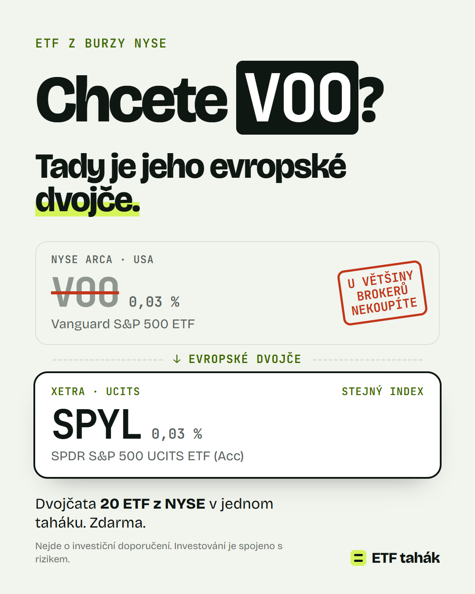
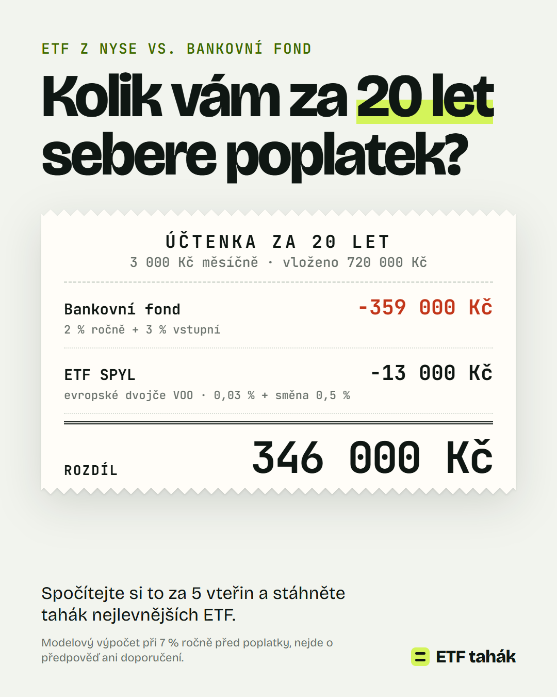

# Dvě verze reklamy

Obě reklamy jsou připravené pro Meta (Instagram + Facebook: Feed, Stories, Reels) a obě vedou na **finální stránku** (varianta B, `/`). Kreativy se generují z `ads/creative.html` stejnými daty a stejným vzorcem jako stránka (`tools/render_ads.py`), takže číslo v reklamě vždy sedí s číslem na stránce. Vzhled reklam odpovídá stránce: světlé pozadí, stejné písmo, inkoustová + limetková.

| | Reklama 1 — Dvojče | Reklama 2 — Účtenka |
|---|---|---|
| Úhel | Problém + zvědavost („proč VOO nejde koupit?“) | Peníze + překvapení („kolik mě stojí poplatky?“) |
| Pro koho | Samouk z Instagramu, zná VOO/SPY/QQQ | I bankovní střadatel, ETF zná jen z doslechu |
| Landing page | `/` (účtenka v první obrazovce obsahuje řádek „VOO z NYSE → Dvojče SPYL“) | `/?m=3000&y=20` (stejná účtenka jako v reklamě) |
| Feed 4:5 | `ads/ad-1-dvojce-feed.png` | `ads/ad-2-uctenka-feed.png` |
| Stories/Reels 9:16 | `ads/ad-1-dvojce-story.png` | `ads/ad-2-uctenka-story.png` |

U reklamy 2 jsou slib reklamy a první obrazovka stránky **stejná věta a stejný obrázek** — návštěvník během první vteřiny pozná, že je na správném místě.

**Pozor u reklamy 1:** byla navržená pro variantu A (vyhledávač dvojčat). Na finální stránce B najde návštěvník VOO a jeho dvojče SPYL hned v účtence, ale nadpis mluví o poplatcích, ne o dvojčeti. Když bude mít reklama 1 dobré CTR a slabou konverzi, je to důvod — pak buď běžet jen s reklamou 2, nebo reklamu 1 přepsat na úhel poplatků.

---

## Reklama 1 — „Dvojče“

**Primární text** (prvních ~125 znaků je vidět bez „Zobrazit víc“):
> VOO, SPY ani QQQ vám většina brokerů v Česku neprodá (XTB, Trading 212, DEGIRO…). Ke každému ale existuje evropské „dvojče“ se stejným indexem.
>
> Srovnali jsme 20 známých ETF z burzy NYSE: poplatky, výnosy a jejich dvojčata, která si koupíte normálně. Plus poplatky 6 brokerů a daně na jedné stránce.
>
> Tahák v PDF zdarma. Stačí e-mail, žádný telefon.

**Nadpis:** Chcete VOO? Tady je jeho dvojče
**Popis:** 20 ETF z NYSE + dvojčata · PDF zdarma
**Tlačítko:** Stáhnout
**URL:** `https://[doména]/?utm_source=meta&utm_medium=paid_social&utm_campaign=etf_tahak_2026&utm_content=ad1_dvojce`

**Varianty textu na test (stejný vizuál):**
- „Hledáte VOO u XTB nebo Trading 212 a nejde to? Není to chyba aplikace…“
- Vizuál s SPY nebo QQQ místo VOO: finální stránka počítá s VOO, takže tuto variantu zatím netestovat.

---

## Reklama 2 — „Účtenka“

**Primární text:**
> Stejné akcie, jiný poplatek. Typický akciový fond od banky si bere kolem 2 % ročně a k tomu vstupní poplatek. ETF z americké burzy NYSE a jejich evropská dvojčata začínají na 0,03 %.
>
> Při 3 000 Kč měsíčně je to za 20 let rozdíl ve stovkách tisíc korun. Spočítejte si to sami za 5 vteřin.
>
> Výpočet a tahák nejlevnějších ETF pošleme zdarma do e-mailu.

**Nadpis:** Účtenka za 20 let investování
**Popis:** Kalkulačka poplatků + tahák zdarma
**Tlačítko:** Zjistit více
**URL:** `https://[doména]/?m=3000&y=20&utm_source=meta&utm_medium=paid_social&utm_campaign=etf_tahak_2026&utm_content=ad2_uctenka`

V kreativě je drobným písmem předpoklad výpočtu (7 % ročně před poplatky, modelový výpočet) — tvrzení „rozdíl ve stovkách tisíc“ je tak podložené a dohledatelné na stránce („Jak počítáme“).

---

## Nastavení kampaně (návrh)

- **Cíl:** Potenciální zákazníci (Leads) s konverzí na webu, událost `Lead` z Meta Pixelu (vyvolá se jednou po úspěšném odeslání formuláře, na děkovací stránce, s `eventID` pro spárování) + doporučeně Conversions API ze serveru. Zapojení a kontrola: `docs/spusteni.md` §4.
- **Publikum:** ČR, 22–45 let, Advantage+ audience se signály: investování, ETF, akcie, XTB, Trading 212, Portu, finanční gramotnost. Vyloučit stávající kontakty (nahraný seznam).
- **Umístění:** Advantage+ placements; kreativa 4:5 pro feed, 9:16 pro Stories/Reels.
- **Rozpočet testu:** 2 reklamy × 1 stránka, rovnoměrně, cca 7 dní nebo 300 návštěv na reklamu; rozhoduje cena za `Lead`.
- **Pozor na zakázané praktiky:** žádné garantované výnosy, žádné celebrity, žádný vzhled falešného zpravodajského článku, žádné „zbohatněte“. Cílit 18+.

## Kde reklamu spustit (stav k 29. 10. 2026, zdroje v `research/cz-context.md` §7)
| Platforma | Den 1? | Proč |
|---|---|---|
| **Meta** (Instagram, Facebook) | **Ano** | ČR není na seznamu zemí s povinným ověřením finančního inzerenta. Reklama, která produkt jen zmiňuje bez možnosti ho rovnou koupit, smí běžet bez licence. Povinná pole DSA (inzerent a plátce) vyplnit; nový účet může Meta podržet kvůli ověření identity → založit business portfolio dnes. |
| **Google Ads** | **Ne** | Od 15. 9. 2026 platí i pro ČR ověření finančních služeb (Financial Services Verification). Týká se i nefinančních inzerentů, kteří cílí na lidi hledající finanční služby. Ověření (G2RS) zahájit hned; do té doby žádné finanční klíčové slovo. Stránka musí ukazovat adresu provozovatele a poplatky. |
| **TikTok** | **Ne** | Česká pravidla vyžadují licenci a zakazují poradenské služby; výjimku pro vzdělávací obsah jsme nenašli. Ověřit u zástupce TikToku. |
