# Competitor research – ETF cheat-sheet lead magnet (mobile first)

Captured **2026-10-29** with `tools/shot.py` (Playwright + local Edge, iPhone-like 390×844 viewport, `cs-CZ`).
Per competitor there are three shots: `*-m1-raw.webp` (mobile first screen at 2.5 s, cookie banner as a visitor sees it), `*-m-full.webp` (mobile full page after clicking the most privacy-preserving cookie option where it was found, clipped at 6 000 CSS px) and `*-d1.webp` (desktop 1440×900). Structured data for every field below: [`competitors.json`](competitors.json). Screenshots are stored as WebP (quality 78) to keep the repository small.

How the numbers were measured:
- **Page weight**: bytes transferred and request count for a mobile load before consent. Headless browser on a fast local line, so the LCP values only compare pages with each other. On real 4G, expect "heavy" pages to be 2–4× slower.
- **Cookie cover**: the share of the mobile first screen covered by the consent panel. It is a visual estimate, cross-checked by sampling a grid of screen points. "Dims" means a full-screen backdrop blocks the page.
- **No forms were submitted**, no account was created and nobody logged in. What happens after sign-up comes only from the page's own copy and FAQ.

---

## 1. Overview

| # | Competitor | Type | Hook / lead magnet | Value shown before the ask | Fields | Moment of ask | Cookie cover (mobile) | Weight | Threat |
|---|---|---|---|---|---|---|---|---|---|
| 1 | [XTB – Nejoblíbenější ETF 2026](#1-xtb--e-book-nejoblíbenější-etf-u-xtb-pro-rok-2026) | Lead magnet (broker) | Free PDF "Nejoblíbenější ETF v XTB" | 3 generic bullets, no fund named | **4** + 2 checkboxes (incl. phone) | On load, form above benefits on mobile | 29 %, accept-only | 1.1 MB, slowest LCP | **Highest** (same offer, biggest ad spend) |
| 2 | [Portu – e-book + calculator](#2-portu--e-book-5-kroků-k-chytrému-investování--calculator) | Lead magnet + calculator | "5 kroků k chytrému investování" | Checklist; calculator on homepage | **1** (e-mail) | Inline, 2nd screen | 0 % (LP) / 33 % (home) | 0.6 MB LP / 2.3 MB home | High (best form UX) |
| 3 | [Investování pro holky](#3-investování-pro-holky--e-book--free-etf-webinar) | Creator (paid e-book + free webinar) | Free ETF webinar; 690 Kč e-book with free sample | Founder story | 1 (e-mail) | Immediately; comment-to-DM ads | 52 % | 0.4 MB / 3 MB | Medium (IG-native) |
| 4 | [Špecialista na investovanie (SK)](#4-špecialista-na-investovanie-sk--etf-zadarmo) | Lead magnet (advisor) | "Ako zarábať na indexových fondoch" 0 € / 5 € / 47 € | None | 1, on a 2nd page | On load | 0 % | 0.5 MB | Low |
| 5 | [Finex.cz](#5-finexcz--etf-screener--sp-500-comparison) | Screener + content | none (Premium/Club) | 71 ETFs, mostly US-listed | 0 | – | 57 % + dims | 0.6 MB | Medium (SEO, brand) |
| 6 | [Finorum (CZ)](#6-finorum-cz--americké-etf-v-česku--čím-nahradit-voo) | Content, the same "twins" pitch | Newsletter pop-up | VOO/SPY/QQQ → UCITS table (after the pop-ups) | 1 | Pop-up on load | **~88 %** with pop-up | 0.35 MB | **High on content** |
| 7 | [Direct Fondee](#7-direct-fondee--homepage--calculator) | Calculator + onboarding | Questionnaire / calculator | Calculator | – | CTAs per section | 50 % | 1.3 MB | Low |
| 8 | [XTB – Investiční plány](#8-xtb--investiční-plány) | Broker LP | 0 % fees, from 15 EUR | Fee facts | – | Hero CTA | 26 %, accept-only | 1.5 MB | Low (destination, not rival) |
| 9 | [DEGIRO – Nákup ETF](#9-degiro--nákup-etf) | Broker LP | Low fees, 100 awards | UCITS funds with ISIN, fee cards | – | Hero CTA | 0 % | 1.1 MB | Low |
| 10 | [LYNX – ETF broker](#10-lynx--etf-broker-lp) | Broker LP (no CZ e-book found) | – | Feature bullets | – | Header only | 0 % | 0.76 MB | Low |
| 11 | [Trading 212 CZ](#11-trading-212-cz) | Broker LP | Commission-free | – | – | Hero CTA | 57 % + dims | 4 MB | Low |
| 12 | [justETF](#12-justetf) | Screener / portfolio builder | Free account, newsletter | Full tools (after consent) | 1 | Hero CTA | **~100 %** (2 modals) | 1.5 MB | Medium (reference) |
| 13 | [extraETF](#13-extraetf) | Tracker (freemium) | Free account + Live-Demo | Demo, search | 1 | Hero CTA | 0 % | 1.2 MB | Reference |
| 14 | [Finanzfluss ETF-Suche](#14-finanzfluss--etf-suche) | Screener | – | **Real UCITS rows with TER on screen 1** | 0 | – | 0 % | 1.2 MB, 205 req. | Reference |
| 15 | [Financial Expert Class](#15-financial-expert-class--the-european-etf-starter-kit) | Lead magnet (UCITS, EN) | 12-page "European ETF Starter Kit" | Very specific bullets with tickers | **2** | After the bullets | 0 % | **0.28 MB** | Best-practice model |
| 16 | [EU ETF Scan – VOO](#16-eu-etf-scan--european-alternatives-to-voo) | Twin finder (EN) | – (no capture) | **Best UCITS match card for VOO** | 0 | Never | 0 % | **95 KB** | High on concept |
| 17 | [Index Masterclass](#17-index-masterclass-tom-crosshill) | VSL / course (EN, ads in CZ) | Free training → paid course | Video, story | 1 | Every section | 0 % | 4.5 MB, 41k px | Low (different price point) |
| – | [Light entries](#light-entries) | Revolut, Investiční web, Peníze.cz, Kurzy.cz, Průvodce investicemi, ISJ, Bankovnipoplatky | | | | | | | |
| – | [Meta Ad Library](#meta-ad-library-cz-keyword-etf) | ~180 active "ETF" ads in CZ | | | | | | | |

---

## 2. Competitors

### 1. XTB – e-book „Nejoblíbenější ETF u XTB pro rok 2026“
<https://cz.xtb.com/nejoblibenejsi-etf-v-xtb> · lead magnet (broker) · related ad LPs: `vzdelavani.xtb.com/nemovitosti-vs-akcie-a-etf`, `cz.xtb.com/tvorba-akcioveho-portfolia`

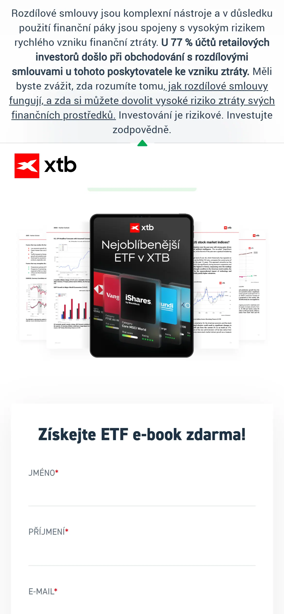 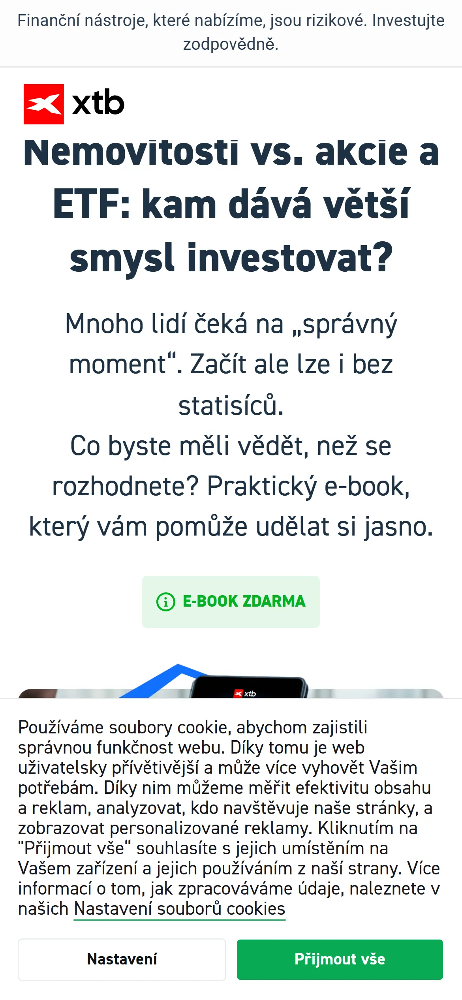 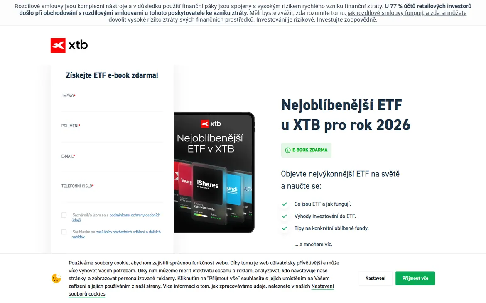

Full page: [shots/xtb-ebook-m-full.webp](shots/xtb-ebook-m-full.webp) · ad LPs: [nemovitosti full](shots/xtb-nemovitosti-m-full.webp), [kurz m1](shots/xtb-kurz-m1-raw.webp), [kurz full](shots/xtb-kurz-m-full.webp), [kurz desktop](shots/xtb-kurz-d1.webp)

- **H1:** „Nejoblíbenější ETF u XTB pro rok 2026“. **Sub:** „Objevte nejvýkonnější ETF na světě a naučte se: Co jsou ETF a jak fungují. / Výhody investování do ETF. / Tipy na konkrétní oblíbené fondy. / … a mnohem víc.“ The form is titled „Získejte ETF e-book zdarma!“
- **What the first screen says in 3 s:** a grey CFD loss warning takes the top ~24 %. Below it are the logo, a tablet mockup of the PDF and the start of the form. At 2.5 s the H1 had **not rendered yet**, so the visitor reads "XTB wants my details" before any benefit.
- **Value before the form:** none to speak of. The page names no fund, and the mockup only shows Vanguard, iShares and Amundi logos.
- **Lead magnet:** the PDF "Nejoblíbenější ETF v XTB", which shows the ETFs XTB clients hold most. No page count is given.
- **Interactive:** FAQ only.
- **Form:** **4 required fields**: Jméno, Příjmení, E-mail, Telefonní číslo. Also two checkboxes (privacy terms; consent to commercial messages) and the button ODESLAT.
- **Moment of the ask:** on load. On mobile the form comes *before* the benefit list.
- **After submit (FAQ):** the e-book is e-mailed "okamžitě", and XTB may send further offers. No call is mentioned, but a mandatory phone number implies sales follow-up.
- **Trust signals:** the XTB brand, a strip of award logos, risk text and the company ID. The two CFD figures contradict each other (74 % vs 77 %).
- **Cookie banner:** a bottom bar covering ~29 %, offering only "Nastavení" and "Přijmout vše".
- **Weight/speed:** 1.1 MB, 112 requests and the slowest LCP in the set (~3.6 s locally).
- **Tone:** corporate-promotional ("nejvýkonnější ETF na světě"), formal vykání.
- **Ad-funnel variants:** the same template is reused for "Nemovitosti vs. akcie a ETF: kam dává větší smysl investovat?", the most frequent landing page in the ad sample. Its H1 is visible on screen 1, with a strong "dilemma" hook. "Jak si vytvořit první portfolio" adds an "AKTUÁLNÍ PRO ROK 2026:" eyebrow and a "KURZ ZDARMA" badge.
- **Steal:** the year in the headline, the "E-BOOK ZDARMA" pill under the H1, the PDF device mockup, and an FAQ that pre-empts "is it really free / do I need an account / will you spam me". The ad-to-LP message match is good.
- **Avoid:** 4 fields including phone, a legal block as the first thing on mobile, a late-rendering H1, no value shown before the ask, an accept-only cookie bar and hype superlatives.

### 2. Portu – e-book „5 kroků k chytrému investování“ + calculator
<https://magazin.portu.cz/e-book-ke-stazeni/> · lead magnet + calculator (robo-advisor) · homepage <https://www.portu.cz/>

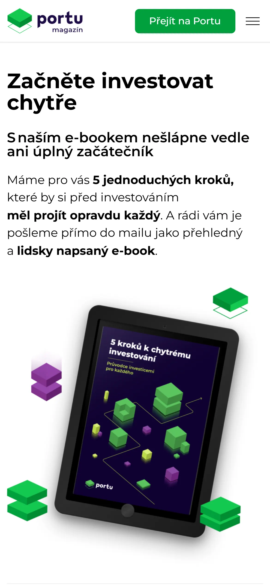 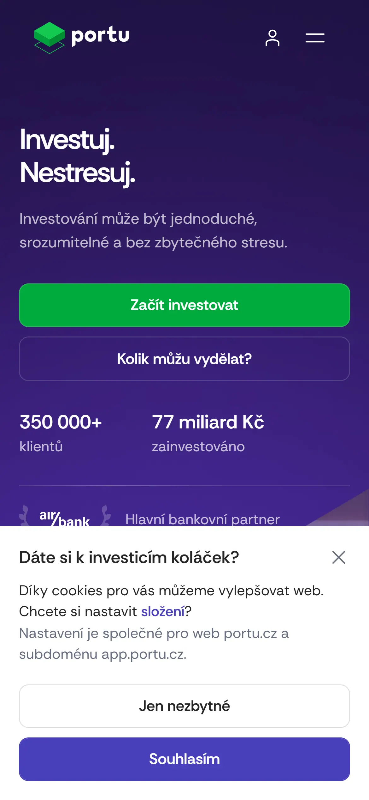 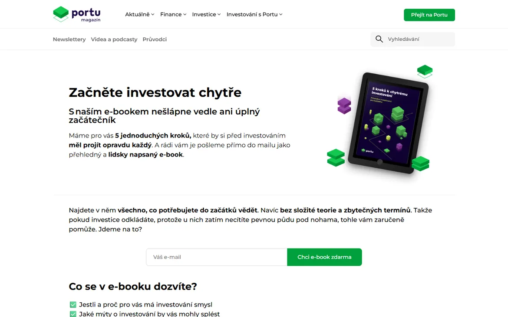

Full: [e-book LP](shots/portu-ebook-m-full.webp) · [homepage incl. calculator](shots/portu-m-full.webp) · [home desktop](shots/portu-d1.webp)

- **H1:** „Začněte investovat chytře“. **Sub:** „S naším e-bookem nešlápne vedle ani úplný začátečník“ and „…5 jednoduchých kroků… pošleme přímo do mailu jako přehledný a lidsky napsaný e-book.“ The homepage H1 is „Investuj. Nestresuj.“
- **3 s:** the e-book LP is a clean, clear promise with a big tablet mockup, but the e-mail field is *not* on screen 1. The homepage shows the H1, a green "Začít investovat" button, "Kolik můžu vydělat?", 350 000+ klientů and 77 miliard Kč, all under a cookie sheet.
- **Value before the form:** a 5-point "Co se v e-booku dozvíte?" list. The homepage has a full **calculator** with no sign-up: slider, Konzervativní/Vyvážené/Růstové, a chart for 2027–2047, "1 615 845 Kč Tolik můžete s Portu mít za 20 let" and a DIP checkbox.
- **Lead magnet:** "5 kroků k chytrému investování – Průvodce investicemi pro každého", delivered by e-mail.
- **Form:** **1 field** (e-mail), button "Chci e-book zdarma". It sits inline after the intro, which is screen 2 on mobile and above the fold on desktop.
- **After submit:** the e-book arrives "přímo do mailu", then the page pushes "Začít investovat".
- **Trust:** "99,5 % všech našich klientů na investicích vydělává" (after 3 years). The homepage adds 350 000+ clients, 77 bn Kč, a 10.39 % 10-year return and Air Bank as partner.
- **Cookie:** none on the magazín LP. The homepage sheet covers ~33 % ("Dáte si k investicím koláček?") and gives "Jen nezbytné" equal weight with accept.
- **Weight:** the LP is 0.6 MB / 19 requests. The homepage is heavy: 2.3 MB / 227 requests.
- **Tone:** friendly, human Czech, light humour.
- **Steal:** a one-field form, "lidsky napsaný" as a promise of tone, a calculator as a no-commitment value moment, and playful but fair cookie copy.
- **Avoid:** the form missing from mobile screen 1, a **horizontal overflow bug** that clips text on the right edge, a generic (non-ETF) e-book, and return-based trust claims.

### 3. Investování pro holky – e-book + free ETF webinar
<https://investovaniproholky.cz/e-book/> · creator · webinar LP from the Meta ads: <https://vzdelavani.investovaniproholky.cz/pages/webinar-zdarma-investovani-jednoduse>

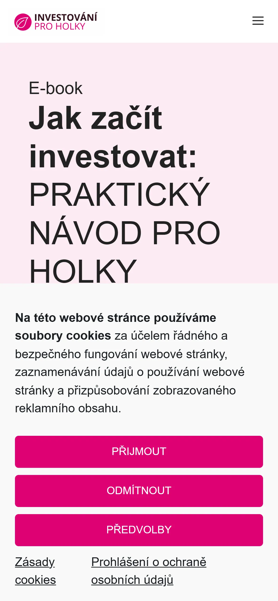 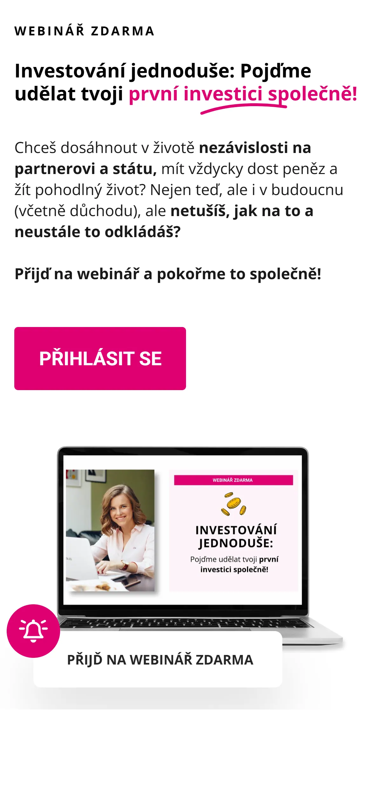 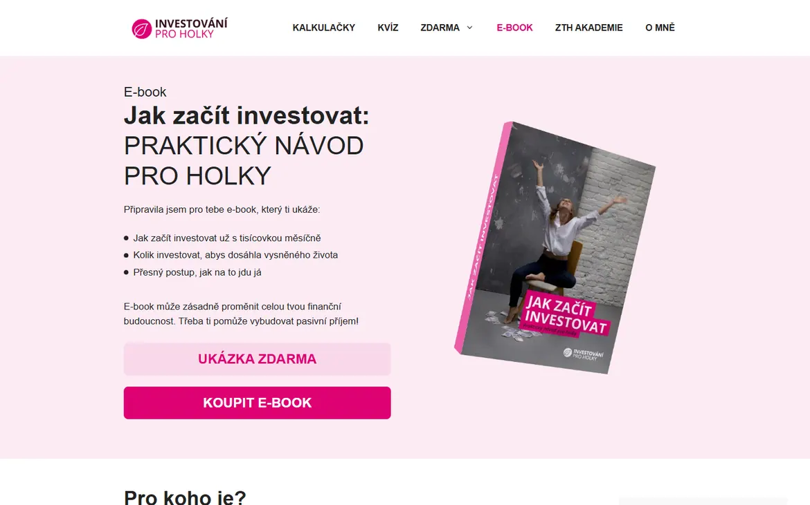

Full: [e-book](shots/ipholky-m-full.webp) · [webinar](shots/ipholky-webinar-m-full.webp) · [webinar desktop](shots/ipholky-webinar-d1.webp)

- **H1:** "E-book – Jak začít investovat: PRAKTICKÝ NÁVOD PRO HOLKY". **Sub:** „Připravila jsem pro tebe e-book, který ti ukáže: Jak začít investovat už s tisícovkou měsíčně / Kolik investovat, abys dosáhla vysněného života / Přesný postup, jak na to jdu já“. The webinar H1 is „Investování jednoduše: Pojďme udělat tvoji první investici společně!“
- **3 s:** on the e-book page, the giant title plus a cookie block over the lower half hide the offer. The **webinar LP is crystal clear**: "WEBINÁŘ ZDARMA", a personal promise, a magenta "PŘIHLÁSIT SE" button and the author's face.
- **Value before the form:** the founder's story (from a savings account to low-cost ETFs), "Pro koho je?" and Facebook recommendation screenshots.
- **Lead magnet:** a **paid** e-book (~50 pages, 690 Kč) with a free sample behind an e-mail form (Brevo). There is also a free webinar and freebies (10 kroků, a budget table, calculators, a quiz).
- **Form:** e-mail (Brevo form, not inspected in detail). The ask is immediate. The ads use **comment-to-DM**: "Napiš „chci investovat“ do komentáře a pošlu ti odkaz".
- **After submit:** a webinar link by e-mail, implied by the form. The site header points to a paid "ZTH akademie" (not verified).
- **Trust:** a real face and story, a niche identity, testimonials dated 2020–2021.
- **Cookie:** ~52 % with three equal buttons; none on the webinar LP.
- **Weight:** 0.4 MB for the e-book page, 3 MB for the webinar LP.
- **Tone:** tykání, emotional ("nezávislost na partnerovi a státu"), aspirational ("milionářkou").
- **Steal:** an identity hook with a human face, the comment-to-DM mechanic, and "uděláme tvoji první investici společně" as an action promise.
- **Avoid:** confusion between free and paid, get-rich framing, stale testimonials, and a half-screen cookie block.

### 4. Špecialista na investovanie (SK) – „ETF zadarmo“
<https://specialistanainvestovanie.sk/etf-zadarmo/> · advisor lead magnet with tiers

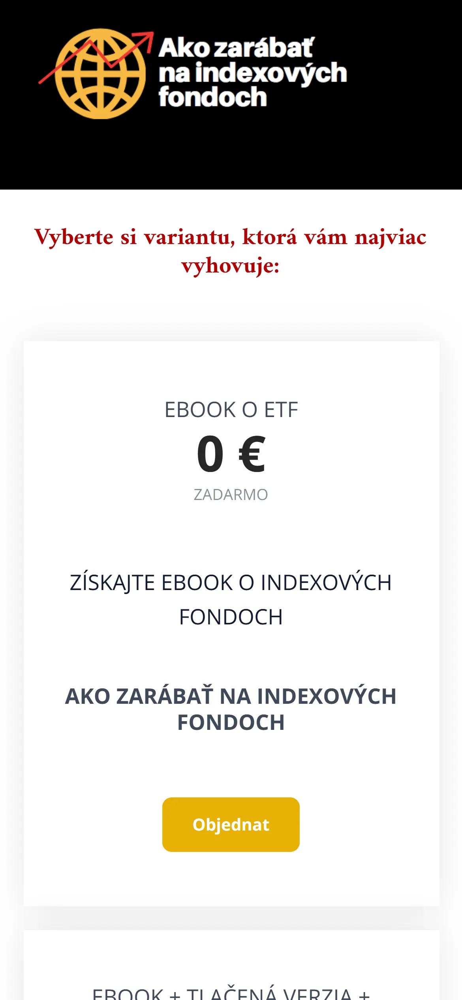 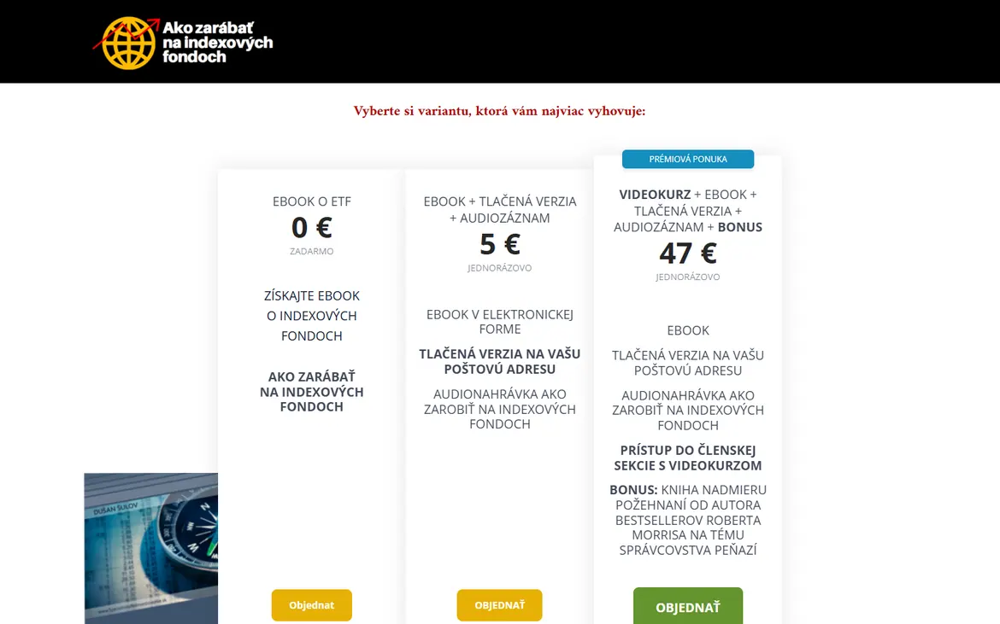

Full: [shots/specialista-m-full.webp](shots/specialista-m-full.webp)

- **H1:** none. The logo reads "Ako zarábať na indexových fondoch" and the first line is „Vyberte si variantu, ktorá vám najviac vyhovuje:“. The cards are 0 € EBOOK O ETF / 5 € print + audio / 47 € video course + bonus.
- **3 s:** clearly free, but it is unclear what is inside or who the author is.
- **Value before the form:** none: no contents, no sample, no credentials.
- **Interactive:** a countdown "Špeciálna ponuka končí o:" stuck at **00:00:00:00**.
- **Form:** "Objednat" leads to a second page (`/email-etf/`) with an e-mail form, which adds an extra click.
- **After submit:** not stated.
- **Trust:** a named person and phone number. Two different e-mail domains in the footer (chcemporadit.sk, elitewm.sk) undermine it.
- **Cookie:** none. **Weight:** 0.5 MB.
- **Tone:** old-school direct response.
- **Steal:** price anchoring (free next to 47 €) raises perceived value.
- **Avoid:** the expired fake timer, "Objednat" for a free item, a two-step form and no preview.

### 5. Finex.cz – ETF screener + S&P 500 comparison
<https://finex.cz/etf-screener/> · screener + content · article <https://finex.cz/nejzajimavejsi-etf-fondy-kopirujici-sp-500/>

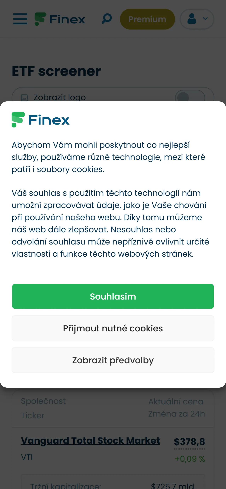 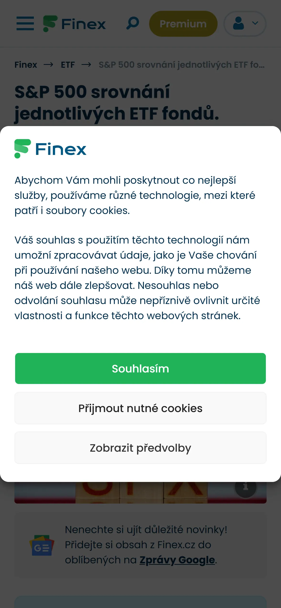 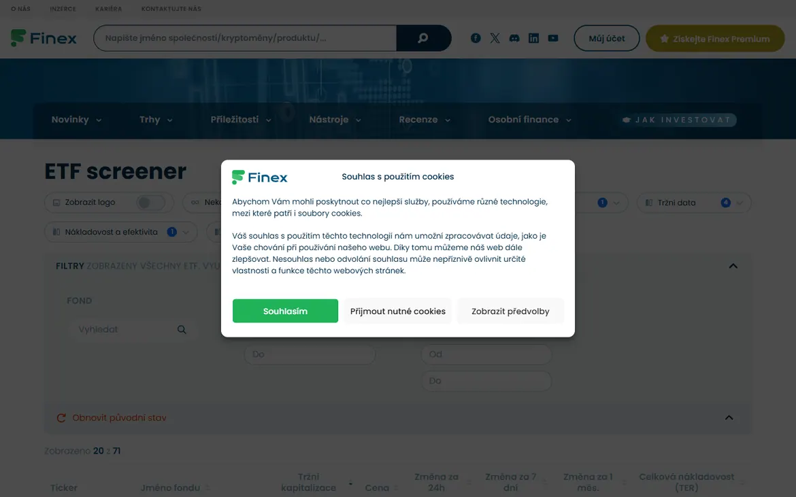

Full: [screener](shots/finex-m-full.webp) · [S&P 500 article](shots/finex-sp500-m-full.webp)

- **H1:** "ETF screener" (no sub). The article H1 is „S&P 500 srovnání jednotlivých ETF fondů.“
- **3 s:** only the words "ETF screener" are visible. A cookie modal covers ~57 % and **dims the rest**.
- **Value:** after consent, 71 ETFs as cards (VTI, SPY, QQQ, IWF…) with market cap, % change and TER, plus filters. They are **mostly US-listed**, with no UCITS filter and no "can I buy it in CZ" flag. The article does explain PRIIPs, names Fio e-Broker and Patria as the exceptions for US ETFs, and compares UCITS S&P 500 funds.
- **Lead magnet:** none on the page. Finex Premium and Club are upsold in the header, and a free 22-lesson ETF course exists elsewhere.
- **Form:** none. **After submit:** –.
- **Trust:** the biggest Czech investing media brand, broker tests, a community of 5 000+.
- **Cookie:** 57 % plus a dimmed page. "Přijmout nutné cookies" exists, but as a grey secondary button.
- **Weight:** 0.6 MB.
- **Tone:** neutral media.
- **Steal:** TER next to every fund. The "why can't I buy SPY" angle proves the pain is real in CZ.
- **Avoid:** screening funds most Czech retail investors cannot buy, a blocking consent modal, and a desktop table squeezed into mobile cards.

### 6. Finorum (CZ) – „Americké ETF v Česku … čím nahradit VOO“
<https://finorum.com/cs/americke-etf-v-cesku/> · content with the same pitch as ours, plus a newsletter

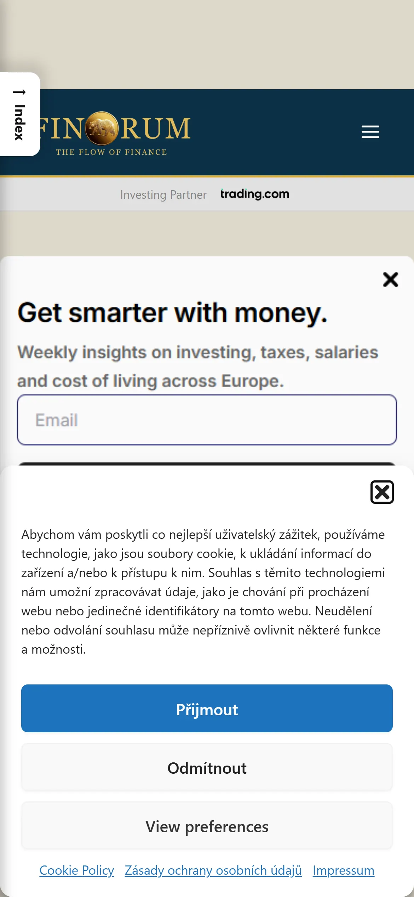 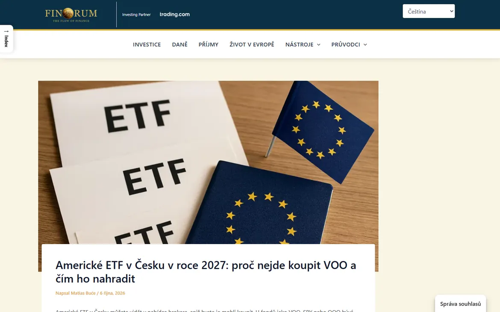

Full: [shots/finorum-m-full.webp](shots/finorum-m-full.webp)

- **H1:** „Americké ETF v Česku v roce 2027: proč nejde koupit VOO a čím ho nahradit“. **Lead:** „Americké ETF v Česku můžete vidět v nabídce brokera, aniž byste je mohli koupit. U fondů jako VOO, SPY nebo QQQ bývá překážkou chybějící dokument KID…“
- **3 s:** **none of the article is visible**. The screen shows an empty ad slot, "Investing Partner trading.com", an *English* newsletter modal ("Get smarter with money.") and a cookie sheet. About 88 % is covered.
- **Value once reachable:** excellent. The table "Čím nahradit VOO, SPY nebo QQQ: rychlé srovnání" lists SPYL, VUAA, VUSA, CSPX and EQQQ with ISIN, acc/dist and TER. The article also covers ČNB and KID, gives a 7-point pre-purchase checklist, discusses tax, and carries the stamp "Zdroje ověřeny 4. října 2026".
- **Lead magnet:** a weekly MailerLite newsletter. **Form:** 1 field (Email). **Moment:** pop-up on load.
- **Trust:** named author, date, a sources-verified stamp, an 11-item table of contents.
- **Cookie:** 48 %, dims the page, reject available. **Weight:** 0.35 MB, but 17 500 px long.
- **Tone:** expert and calm.
- **Steal:** exactly our mapping in Czech with ISINs, the freshness stamp, and the "7 údajů, které musí souhlasit" checklist.
- **Avoid:** a pop-up plus cookie wall on load, English copy on a Czech page, "2027" in a 2026 title (feels SEO-gamed), and no downloadable asset (the table is buried in a long article).

### 7. Direct Fondee – homepage + calculator
<https://www.fondee.cz/cs> · calculator + onboarding

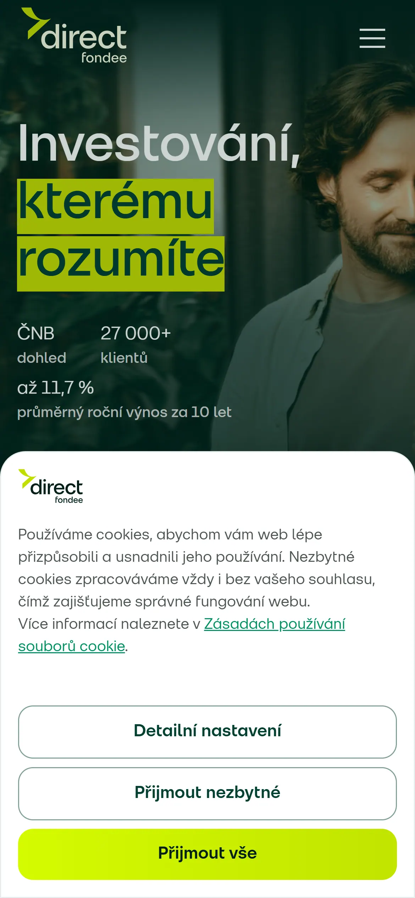 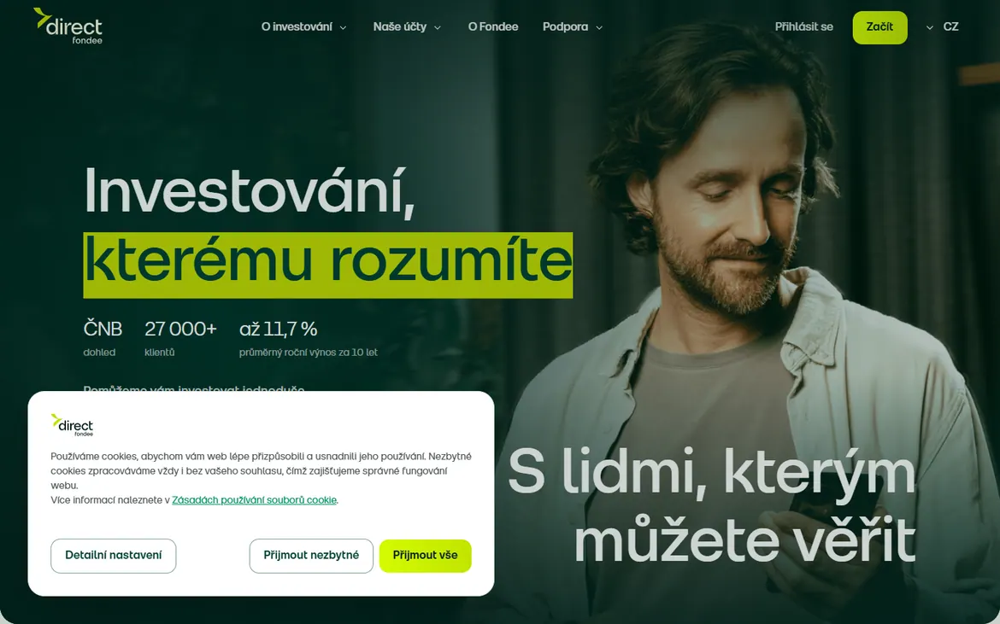

Full: [shots/fondee-m-full.webp](shots/fondee-m-full.webp)

- **H1:** „Investování, kterému rozumíte“. **Sub:** „Pomůžeme vám investovat jednoduše, srozumitelně a z pohodlí gauče.“
- **3 s:** the new "direct fondee" brand, a lime-highlighted H1, and a proof row (**ČNB dohled · 27 000+ klientů · až 11,7 %**). The cookie sheet covers the lower half, so no CTA is visible.
- **Value:** a calculator with defaults of 30 000 Kč + 2 000 Kč/month over 10 years, giving 548 892 Kč, plus 3 "how it works" cards.
- **Lead magnet:** none; the questionnaire is the hook. **Form:** registration. **Moment:** CTAs after every section.
- **Trust:** ČNB supervision, client count, Finex test winner (07/2026), Google reviews.
- **Cookie:** 50 %, "Přijmout nezbytné" on the first layer. **Weight:** 1.3 MB.
- **Tone:** calm, anti-complexity.
- **Steal:** a three-number proof row under the H1, a calculator with sensible defaults.
- **Avoid:** a return figure as the headline trust signal, a CTA hidden by the cookie sheet, and an unexplained rebrand.

### 8. XTB – Investiční plány
<https://www.xtb.com/cz/investicni-plany> · broker LP

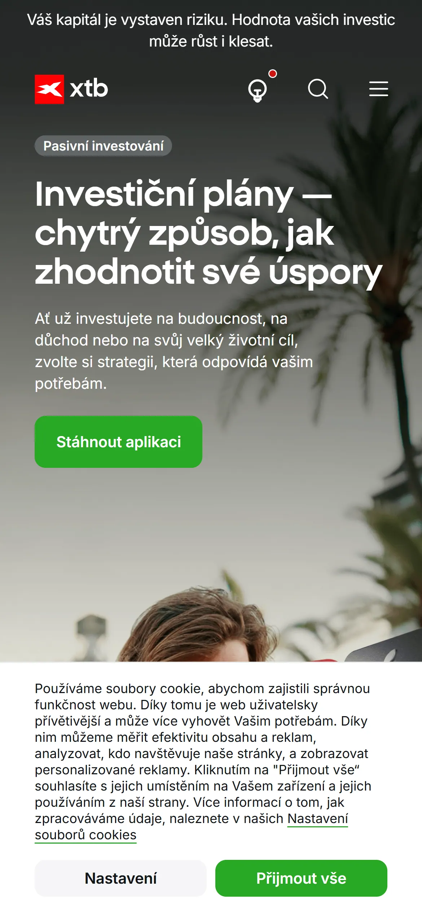 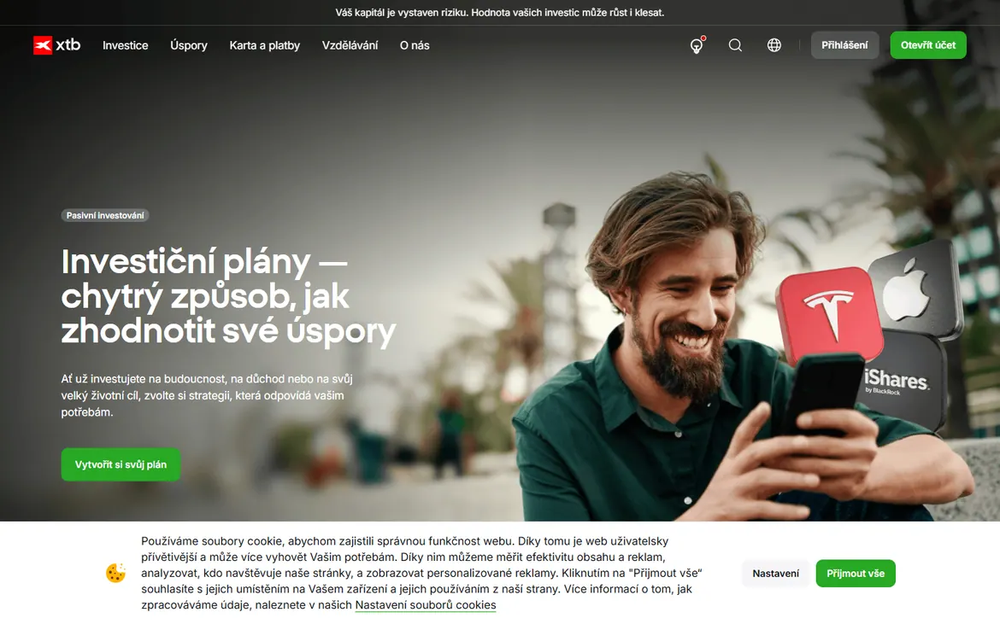

Full: [shots/xtb-plany-m-full.webp](shots/xtb-plany-m-full.webp)

- **H1:** „Investiční plány — chytrý způsob, jak zhodnotit své úspory“. **Sub:** „Ať už investujete na budoucnost, na důchod nebo na svůj velký životní cíl, zvolte si strategii, která odpovídá vašim potřebám.“
- **3 s:** a risk line, a lifestyle hero, H1 and sub, and the green "Stáhnout aplikaci". The cookie bar takes the bottom ~26 %.
- **Value:** 0 % fees up to 100 000 EUR/month, from 15 EUR (the hero says "od 350 CZK", which contradicts it), 1 900+ ETFs, up to 10 free plans.
- **Lead magnet / form:** none. The CTA is app install on mobile and "Vytvořit si svůj plán" on desktop.
- **Trust:** "20 let zkušeností", instrument counts. **Cookie:** 26 %, accept-only. **Weight:** 1.5 MB.
- **Tone:** lifestyle.
- **Steal:** a low entry amount in the hero, a device-aware CTA.
- **Avoid:** conflicting minimums, accept-only consent.

### 9. DEGIRO – Nákup ETF
<https://www.degiro.cz/investovani/nakup-etf> · broker LP

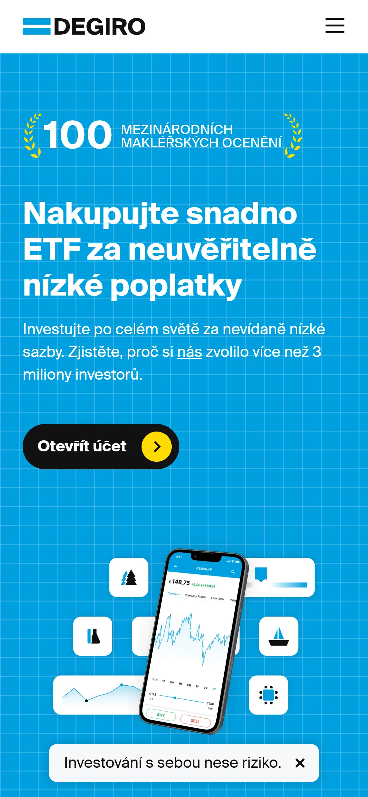 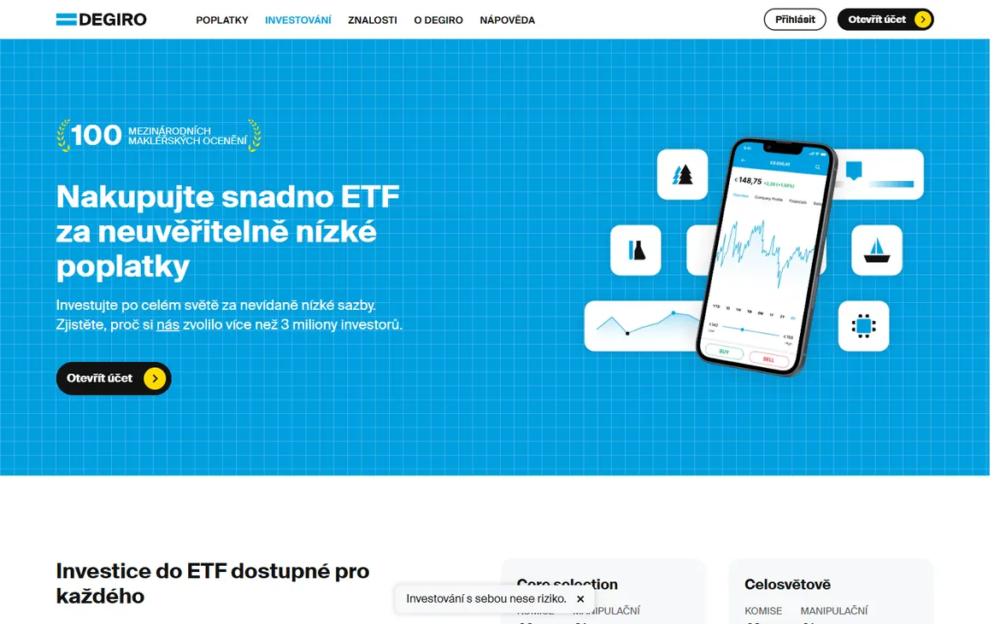

Full: [shots/degiro-m-full.webp](shots/degiro-m-full.webp)

- **H1:** „Nakupujte snadno ETF za neuvěřitelně nízké poplatky“. **Sub:** „Investujte po celém světě za nevídaně nízké sazby. Zjistěte, proč si nás zvolilo více než 3 miliony investorů.“
- **3 s:** a laurel reading "100 mezinárodních makléřských ocenění", the H1, an "Otevřít účet" button and a phone mockup. Clean.
- **Value:** fee cards (Core selection: €0 + €1 handling fee) and "Prohlédněte si nejobchodovanější ETF", which lists iShares Core MSCI World (IE00B4L5Y983) and iShares Core S&P 500 (IE00B5BMR087) **with ISINs**.
- **Lead magnet / form:** none. The ask is account opening.
- **Trust:** awards, 3 M investors, BaFin/DNB/AFM in the footer. **Cookie:** none at capture (risk toast ~6 %). **Weight:** 1.1 MB.
- **Tone:** price-led, confident.
- **Steal:** concrete UCITS funds with ISIN, an award number as eyebrow, plain fee numbers.
- **Avoid:** superlatives.

### 10. LYNX – ETF broker LP
<https://www.lynxbroker.cz/online-broker/etf-broker/> · broker LP

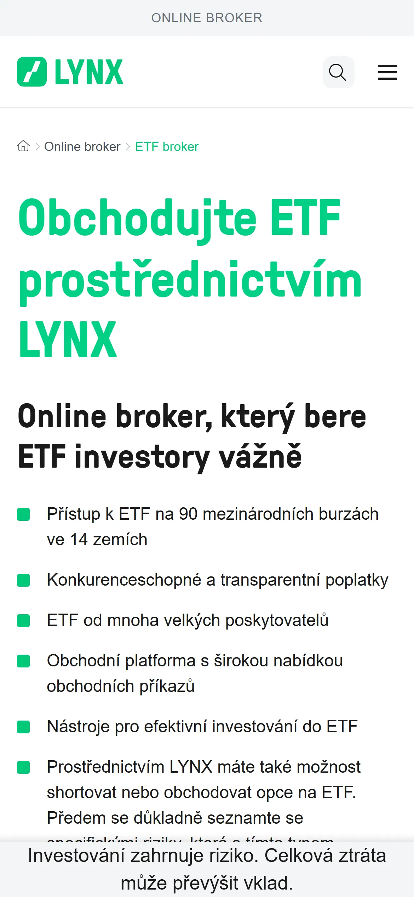 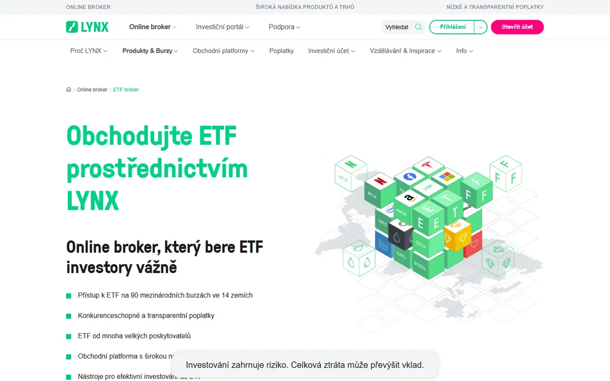

Full: [shots/lynx-m-full.webp](shots/lynx-m-full.webp)

- **Note on e-books:** I found **no Czech ETF e-book or gated guide** on lynxbroker.cz as of 2026-10-29. I checked the education hub, the sitemaps and the "Průvodce obchodováním ETF", which is an open article. Lynx CZ education today is articles, webinars and newsletters (Breakout Trader, Týdenní přehled). Its free e-books and info packs are, per public press, a tactic in other markets such as PL.
- **H1:** „Obchodujte ETF prostřednictvím LYNX“. **Sub (H2):** „Online broker, který bere ETF investory vážně“, followed by 6 bullets (90 burz ve 14 zemích, transparentní poplatky, …).
- **3 s:** a big green H1 and bullets, but **no CTA button** on screen 1, plus a sticky risk footer.
- **Value:** feature bullets. **Lead magnet / form:** none (header "Otevřít účet").
- **Trust:** broker since 2006, awards. **Cookie:** none shown. **Weight:** 0.76 MB, fast.
- **Tone:** serious and trader-ish; it mentions shorting and options on ETFs.
- **Steal:** a fast, uncluttered first screen.
- **Avoid:** no above-the-fold CTA, and trader framing that scares passive beginners.

### 11. Trading 212 CZ
<https://www.trading212.com/cs> · broker LP

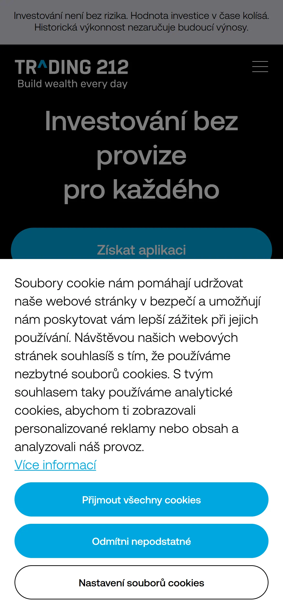 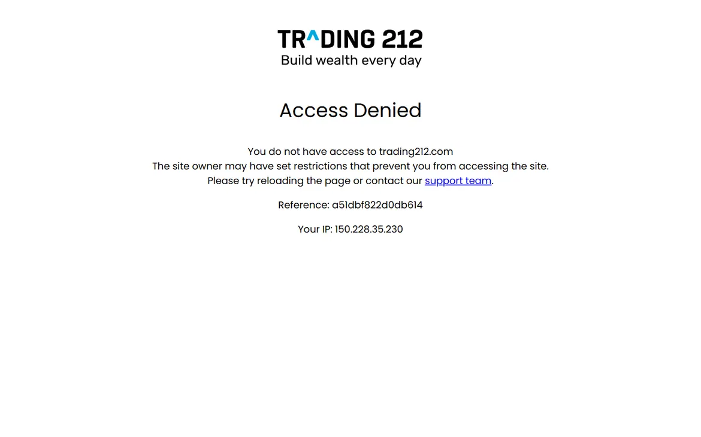

Full: [shots/trading212-m-full.webp](shots/trading212-m-full.webp)

- **H1:** „Investování bez provize pro každého“. There is no separate sub; the logo tagline is "Build wealth every day" and the stats are "30 miliard eur", "5 milionů".
- **3 s:** a risk line, a dark hero, "Získat aplikaci", then a cookie sheet (~57 %) that dims the hero.
- **Lead magnet / form:** none; the ask is app install.
- **Cookie:** 57 % and dims the page; "Odmítni nepodstatné" has the same style as accept. **Weight:** **4 MB**. The desktop request got "Access Denied" (bot protection).
- **Steal:** a 5-word promise plus one CTA. **Avoid:** page weight.

### 12. justETF
<https://www.justetf.com/en/> · screener + portfolio builder (international reference)

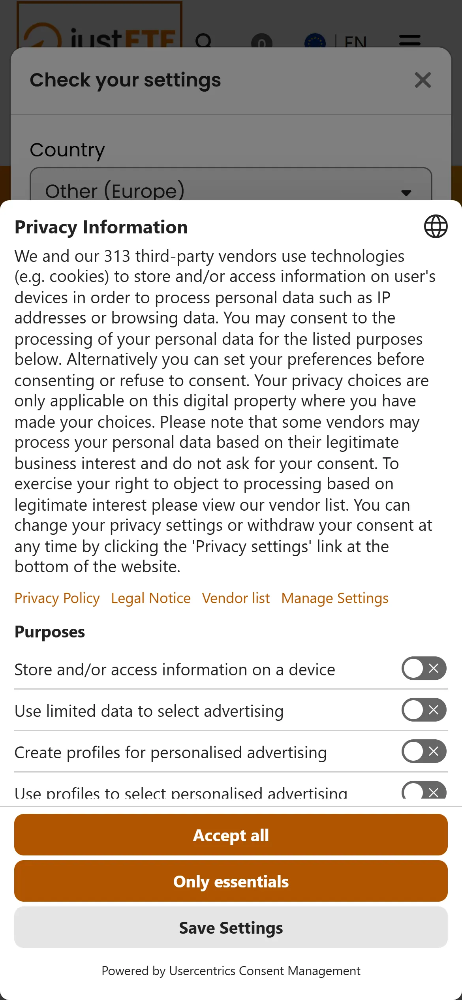 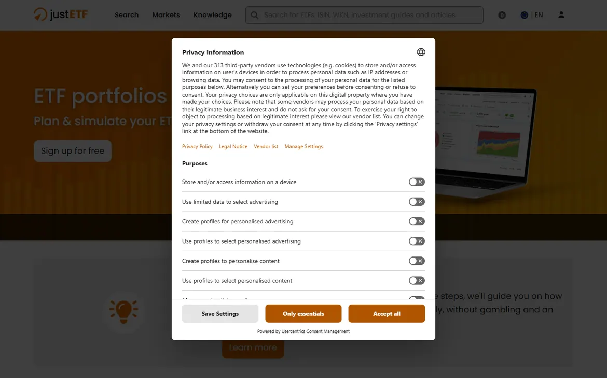

Full: [shots/justetf-m-full.webp](shots/justetf-m-full.webp)

- **Headline:** „ETF portfolios made simple“ (the DOM H1 is "justETF"). **Sub:** „Plan & simulate your ETF strategy“.
- **3 s:** nothing usable. A "Check your settings / Country" modal and a Usercentrics sheet ("We and our 313 third-party vendors…") cover **~100 %** of the mobile screen.
- **Value:** after consent, a free screener, comparison, savings-plan calculator, portfolio simulation and guides, all without login.
- **Lead magnet:** a free account plus the monthly newsletter "Become an ETF expert…". The ask is the hero CTA "Sign up for free".
- **Trust:** a Monevator quote, testimonials, app badges. **Cookie:** ~100 %; "Only essentials" has equal weight. **Weight:** 1.5 MB.
- **Steal:** tools usable before sign-up, and "plan & simulate" as the hook.
- **Avoid:** two stacked modals on mobile load.

### 13. extraETF
<https://extraetf.com/de/> · portfolio tracker (freemium)

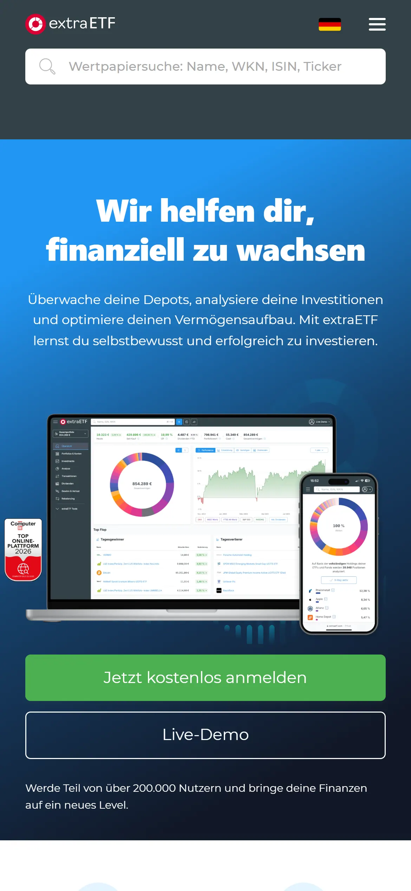 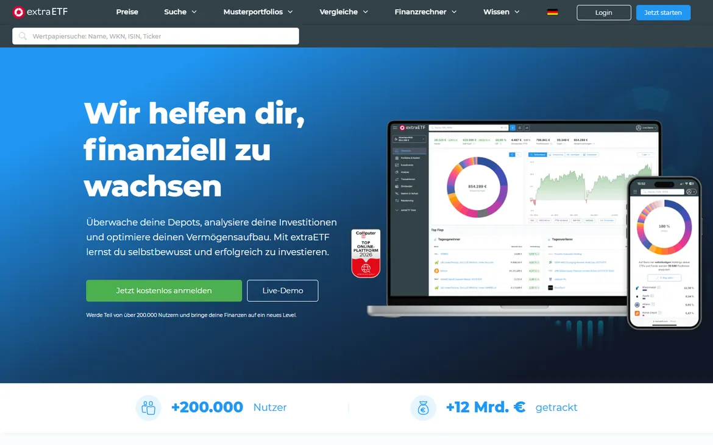

Full: [shots/extraetf-m-full.webp](shots/extraetf-m-full.webp)

- **H1:** „Wir helfen dir, finanziell zu wachsen“. **Sub:** „Überwache deine Depots, analysiere deine Investitionen und optimiere deinen Vermögensaufbau. Mit extraETF lernst du selbstbewusst und erfolgreich zu investieren.“
- **3 s:** a search bar (Name/WKN/ISIN/Ticker), a dashboard mockup with a Computer Bild 2026 seal, "Jetzt kostenlos anmelden" and "**Live-Demo**", and "über 200.000 Nutzer".
- **Value:** the demo before sign-up, fund search. **Form:** account sign-up. **Trust:** seal, 200 000 users, 12 bn € tracked. **Cookie:** none in capture. **Weight:** 1.2 MB, fast LCP.
- **Tone:** du-form, encouraging.
- **Steal:** a "try it first" secondary CTA, search as the first element, a third-party seal next to the CTA.
- **Avoid:** a generic headline without "ETF".

### 14. Finanzfluss – ETF-Suche
<https://www.finanzfluss.de/informer/etf/suche/> · screener (affiliate-funded)

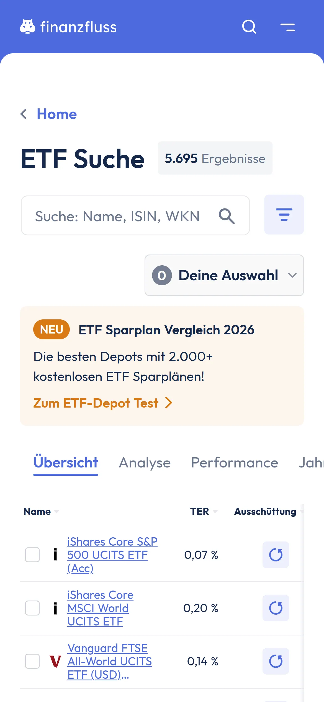 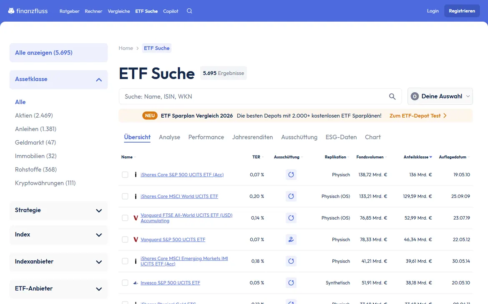

Full: [shots/finanzfluss-m-full.webp](shots/finanzfluss-m-full.webp) · the raw 2.5 s capture was still blank: [m1-raw](shots/finanzfluss-m1-raw.webp)

- **H1:** „ETF Suche“, with "5.695 Ergebnisse" and the banner „NEU ETF Sparplan Vergleich 2026 – Die besten Depots mit 2.000+ kostenlosen ETF Sparplänen!“
- **3 s (once rendered):** real data. A search box (Name, ISIN, WKN), filters and the first UCITS rows with TER: iShares Core S&P 500 UCITS (Acc) 0,07 %, Core MSCI World 0,20 %, Vanguard FTSE All-World 0,14 %.
- **Value:** the full screener (TER, distribution, replication, fund size, tabs) and a step-by-step selection guide.
- **Lead magnet / form:** none on the page. Monetisation is the broker-comparison banner.
- **Cookie:** none in capture. **Weight:** 1.2 MB, **205 requests**, client-side render delay.
- **Steal:** value on screen 1, ISIN search.
- **Avoid:** render delay, wide tables on phones.

### 15. Financial Expert Class – The European ETF Starter Kit
<https://financialexpertclass.com/free-etf-starter-kit/> · lead magnet (UCITS, EN), the best-practice reference

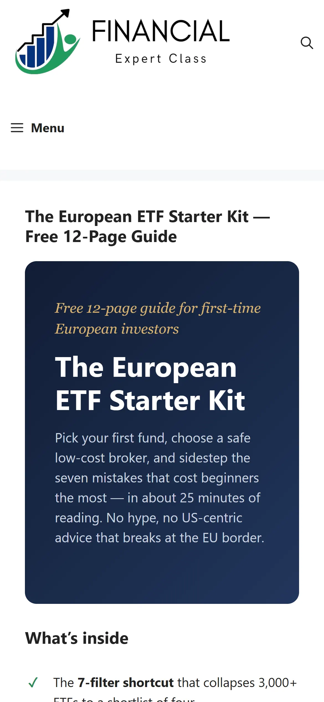 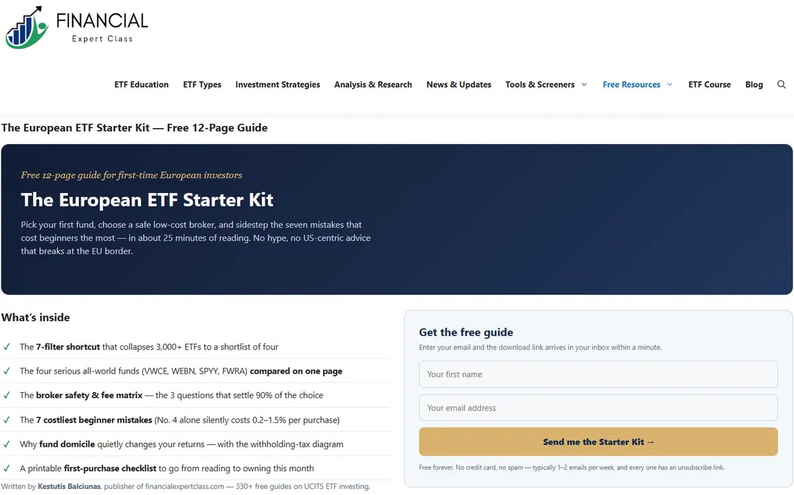

Full: [shots/fec-m-full.webp](shots/fec-m-full.webp)

- **H1:** „The European ETF Starter Kit — Free 12-Page Guide“. **Sub:** „Pick your first fund, choose a safe low-cost broker, and sidestep the seven mistakes that cost beginners the most — in about 25 minutes of reading. No hype, no US-centric advice that breaks at the EU border.“
- **3 s:** the logo and menu waste ~28 %, then the H1 and a navy promise card. It is clear, but there is no form on screen 1.
- **Value before the form:** **specific bullets**: a 7-filter shortcut (3 000+ ETFs → 4), VWCE / WEBN / SPYY / FWRA compared on one page, a broker safety and fee matrix, the 7 costliest mistakes ("No. 4 alone silently costs 0.2–1.5 % per purchase"), a domicile and withholding-tax diagram, and a printable checklist. Author byline.
- **Lead magnet:** a 12-page PDF. **Form:** **2 fields** (first name, email), button "Send me the Starter Kit →". It comes after the bullets: screen 2 on mobile, above the fold on desktop.
- **After submit:** „the download link arrives in your inbox within a minute“, and „Free forever. No credit card, no spam — typically 1–2 emails per week, and every one has an unsubscribe link.“
- **Trust:** named author, "330+ free guides", affiliate disclosure, editorial process, risk disclaimer. **Cookie:** none. **Weight:** **0.28 MB / 16 requests**.
- **Tone:** specific and anti-hype.
- **Steal:** numbers and tickers in the bullets, the "EU border" positioning, delivery-time and frequency microcopy, a reading-time promise.
- **Avoid:** wasted header height on mobile and a form that is not on screen 1.

### 16. EU ETF Scan – European Alternatives to VOO
<https://euetfscan.com/voo/> · twin finder (EN)

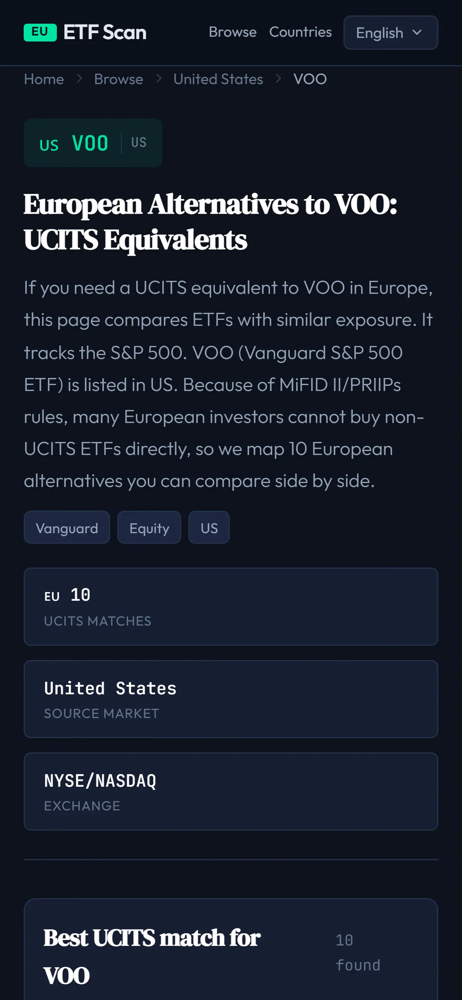 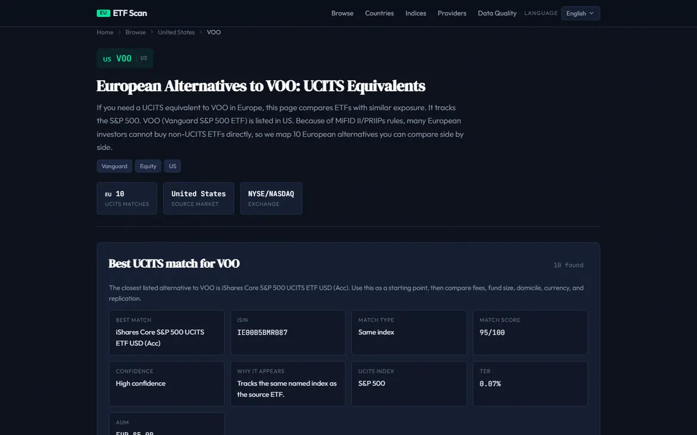

Full: [shots/euetfscan-m-full.webp](shots/euetfscan-m-full.webp)

- **H1:** „European Alternatives to VOO: UCITS Equivalents“. **Sub:** „If you need a UCITS equivalent to VOO in Europe, this page compares ETFs with similar exposure… Because of MiFID II/PRIIPs rules, many European investors cannot buy non-UCITS ETFs directly, so we map 10 European alternatives…“
- **3 s:** a "US VOO" chip, the H1, and tiles "EU 10 UCITS matches / United States source market / NYSE/NASDAQ exchange". This is **our concept, shown value-first**.
- **Value:** a best-match card (CSPX, IE00B5BMR087, "Same index", score 95/100, TER 0.07 %), highlights (lowest TER SPXS 0.05 %, largest fund, share-class mix "8 Acc · 2 Dist · 2 hedged"), a table, a "Compare before choosing" checklist, FAQ, and a data-updated date.
- **Lead magnet / form:** none; the page never asks. **Trust:** match-quality legend, data-quality method, "Not financial advice".
- **Cookie:** none. **Weight:** **95 KB / 6 requests**.
- **Tone:** technical, English.
- **Steal:** the "ticker in → twin out" model, a match score with "why it appears", a data date, tiny page weight.
- **Avoid:** the table overflows horizontally on mobile, and there is no Czech, no broker availability, no CZK context and no relationship with the visitor.

### 17. Index Masterclass (Tom Crosshill)
<https://indexmasterclass.com/training> · VSL / course funnel (EN), running ads in CZ

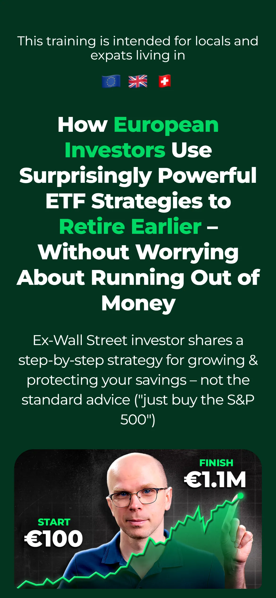 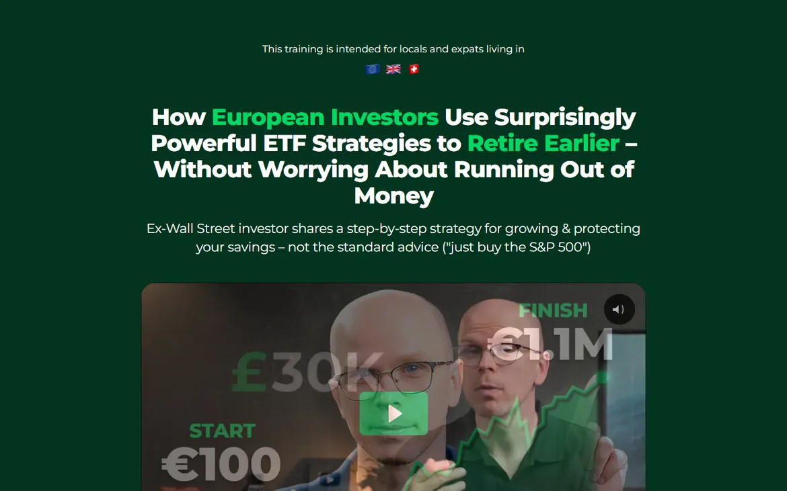

Full: [shots/indexmasterclass-m-full.webp](shots/indexmasterclass-m-full.webp)

- **H1:** „How European Investors Use Surprisingly Powerful ETF Strategies to Retire Earlier – Without Worrying About Running Out of Money“. **Sub:** „Ex-Wall Street investor shares a step-by-step strategy for growing & protecting your savings – not the standard advice ("just buy the S&P 500")“.
- **3 s:** "This training is intended for locals and expats living in" with EU/UK/CH flags, which **qualifies the audience instantly**. The giant headline sits over a "START €100 → FINISH €1.1M" thumbnail.
- **Value:** video, story, curriculum, testimonials. **Ask:** "APPLY NOW" or a free strategy call after every section. The page promises a 6-week plan, support and a 30-day refund.
- **Trust:** Wall Street background, 9 000+ Europeans / 600+ members, Trustpilot. **Cookie:** none. **Weight:** **4.5 MB, 41 000 px**.
- **Steal:** the audience qualifier line ("Pro investory v Česku"). The ad copy lists the 4 European decisions (which ETFs, tax, broker, plan).
- **Avoid:** €100 → €1.1M imagery (misleading, and risky with ČNB rules), extreme length and weight.

### Light entries

| Site | URL | H1 | First screen / note | Weight |
|---|---|---|---|---|
| Revolut – Robo poradce | <https://www.revolut.com/cs-CZ/robo-advisor/> | „Nechte to na Robo poradci“ | Dark hero, truncated CTA "Investovat s Robo porad…", cookie sheet ~36 % dimming the page. Other `/cs-CZ/` investing URLs 404; desktop hit a Cloudflare human check (not bypassed). No Czech ETF LP. | **9.9 MB**, 139 req. |
| Investiční web – tag ETF | <https://www.investicniweb.cz/etf> | „ETF“ | Ticker, promo tiles, 3-line definition, news ("V ETF na index PX je už 100 milionů korun…", 16. 9. 2026). Newsletter further down; no comparison. | 0.4 MB |
| Peníze.cz – téma ETF | <https://www.penize.cz/tema/etf> | „ETF“ | Wall of encyclopedic text on screen 1, no CTA, 23 770 px hub. Měšec.cz has no ETF hub, and its calculators are savings/loans only. | 0.29 MB |
| Kurzy.cz – S&P 500 UCITS ETF | <https://www.kurzy.cz/akcie-cz/akcie/s-p-500-ucits-etf-6201/> | „S&P 500 UCITS ETF - Akcie S&P 500 UCITS ETF aktuálně - akcie online“ | SEO-stacked headings and an ISIN, little data; desktop wrapped in a Datart wallpaper ad. | 0.15 MB |
| Průvodce investicemi (Meta advertiser) | <https://pruvodceinvesticemi.com/e-book/> | „Mějte všechny klíčové investiční taktiky v jednom e-booku“ | Trading e-book (TP/SL, fundamentals). Form with a checkbox "Již jsem v kontaktu s analytikem…", which points to a call-centre funnel. The ads promise an "ETF příručka" via an instant form. No company ID on the page. Cookie ~48 %. | 0.6 MB |
| Investiční spoření jednoduše (Meta advertiser) | <https://isj-invest.cz/> | „PŘIBLIŽUJEME SVĚT INVESTIC BĚŽNÝM LIDEM“ | The ad promises the e-book "Jak sestavit nejlepší investiční portfolio" but lands on the homepage with "Konzultace zdarma" (**message mismatch**). | 1.0 MB |
| Bankovnipoplatky | <https://www.bankovnipoplatky.cz/> | – | `bankovnipoplatky.com` is now a **parked domain**. The `.cz` site is bank news with nothing on ETFs. | – |

Screens: [revolut m1](shots/revolut-m1-raw.webp) · [investicniweb m1](shots/investicniweb-m1-raw.webp) · [penize m1](shots/penize-m1-raw.webp) · [kurzy m1](shots/kurzy-m1-raw.webp) · [pruvodce m1](shots/pruvodce-m1-raw.webp) · [isj m1](shots/isj-m1-raw.webp) · [bankovnipoplatky m1](shots/bankovnipoplatky-m1-raw.webp) (each also has `-m-full` and `-d1`).

### Meta Ad Library (CZ, keyword "ETF")

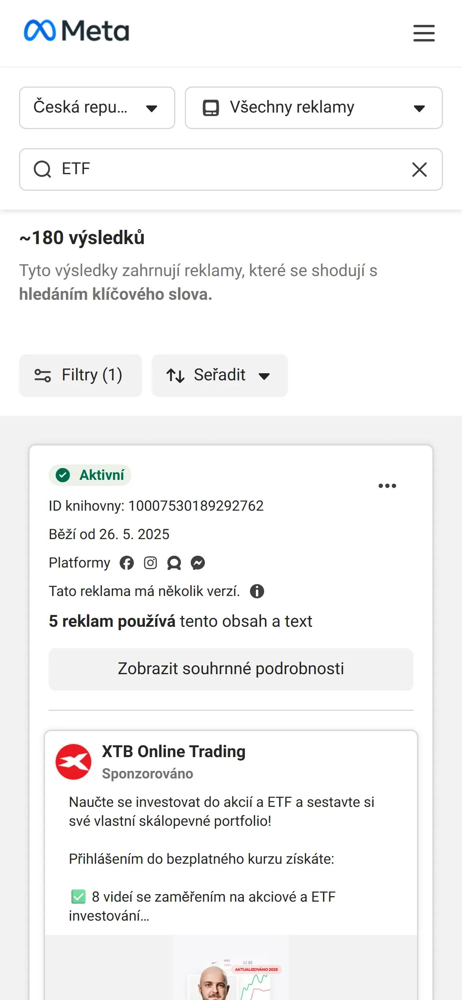 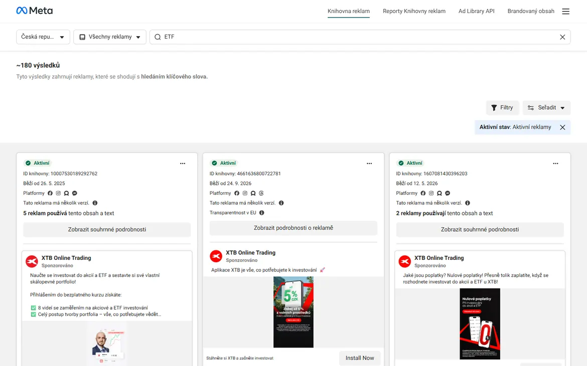

The Ad Library loaded **without login** and showed **~180 active ads** (Czechia, keyword "ETF", 2026-10-29). The sample is the ~95 cards loaded after scrolling; the keyword also pulls in German, Polish and Ukrainian noise.

| Advertiser | Ads in sample | Hooks | Landing pages |
|---|---|---|---|
| **XTB Online Trading** | 37 | Free course "8 videí… skálopevné portfolio" (running since 26. 5. 2025); e-book "Nemovitosti vs. akcie a ETF" (carousel "Byt, nebo trh? / Velké investiční dilema / Stáhni si e-book"); "Myslíš si, že byt je jistota?"; 5 % p.a. on uninvested cash; "Nulové poplatky"; Investiční plány "od 15 EUR"; e-books on defence stocks, "Investování krok za krokem", "Ona investuje" | `vzdelavani.xtb.com/nemovitosti-vs-akcie-a-etf` (most frequent), `cz.xtb.com/tvorba-akcioveho-portfolia`, `akcie.xtb.com/…`, app store |
| Průvodce investicemi | 9 | "…Připravili jsme pro vás příručku… základní stavební kámen pro sestavení vašeho ETF portfolia!" | `fb.me` (instant form / Messenger) |
| Tom Crosshill (Index Masterclass) | 6 | "Investing €500 a month is a good start. But if you also have €30k+… four decisions most online advice skips: Which of 4,000+ European ETFs…" (EN) | `indexmasterclass.com/training` |
| Finademica | 4 | "Deset různých akcií v portfoliu ještě neznamená deset různých rizik…" (AI risk check) | `ai.finademica.com` |
| Investování pro holky | 3 | Free webinar on index ETFs; comment "chci investovat" to get the link by DM | webinar LP |
| Investiční spoření jednoduše | 3 | E-book "Jak sestavit nejlepší investiční portfolio"; "ETF s 0% poplatkem" | homepage / `fb.me` |
| Wellgard (SK) | 3 | "Čo je ETF? Ako fungujú akcie?" (beginner Q&A app) | `wellgard.app` |
| Jiří Novák | 2 | "90 % lidí investuje špatně…" | `metodazkp.cz` |
| HNW advisors (Sehnal, Cimpel, Saturia, Kraľovanský, Vltava Fund) | 8 | "skládanka bez strategie", "Můžu dát 30 milionů do ETF?" | own sites |
| Direct Fondee | 1 | "Jednoduché a férové investování bez zbytečných poplatků." | `fondee.cz` |

**Takeaways from the ads:**
- **Nobody advertises a US-ETF → UCITS comparison or an ETF cheat sheet in CZ.**
- The "ETF" ad space is XTB's education funnels plus advisor call funnels.
- XTB tests *dilemma* hooks (flat vs ETF) and courses more than "list of ETFs" hooks.
- Message mismatch is common: ads promise an e-book and land on a homepage or an instant form.

---

## 3. Synthesis

### Patterns that work on mobile for this audience
1. **Value on the first screen beats a promise.** Only three pages pass a 3-second test with substance: Finanzfluss (real UCITS rows with TER), EU ETF Scan (a "best UCITS match for VOO" card) and Portu's homepage calculator. Every gated PDF page shows only promises above the fold.
2. **A tangible asset.** A device mockup of the PDF, a "ZDARMA" pill and the year (XTB "pro rok 2026", "AKTUÁLNÍ PRO ROK 2026:") make an intangible download feel real and fresh.
3. **Specific bullets convert better than generic ones.** FEC's bullets name tickers (VWCE, WEBN, SPYY, FWRA) and costs (0.2–1.5 % per purchase). XTB's "Tipy na konkrétní oblíbené fondy" names none.
4. **Short forms with reassurance.** Portu asks for one field. FEC asks for two and explains delivery time ("within a minute") and e-mail frequency ("1–2 per week").
5. **A human, identity-led entry for social traffic.** Investování pro holky (a face, tykání, "uděláme tvoji první investici společně") and Index Masterclass ("for locals and expats living in 🇪🇺🇬🇧🇨🇭") qualify the visitor in one line.
6. **A three-number proof row** under the H1 (Fondee, Portu, DEGIRO) is the most compact trust device.
7. **Ad-to-LP message match.** XTB reuses the ad's dilemma as the H1. Advertisers that land on a homepage (ISJ) waste the click.

### What hurts conversion or trust (seen repeatedly)
- **Cookie and pop-up walls.** These cover 50–100 % of the first screen on Finex (dimmed), justETF (two modals), Finorum (cookie plus newsletter, ~88 %), Trading 212, Revolut, Investování pro holky and Fondee. XTB offers no reject button on the first layer.
- **Legal text first and a late headline** (XTB). The H1 had not rendered at 2.5 s.
- **Over-asking:** 4 required fields including phone, for a PDF.
- **Fake urgency** (an expired 00:00:00 timer), **get-rich framing** ("milionářkou", "€100 → €1.1M") and **return-based claims** ("99,5 % vydělává", "až 11,7 %"). Under ČNB scrutiny these erode trust.
- **Mobile bugs and weight:** horizontal overflow (Portu LP, EU ETF Scan table), a truncated CTA (Revolut), 4–10 MB pages (Trading 212, Index Masterclass, Revolut).
- **Mismatch with what Czechs can buy:** Finex screens VTI, SPY and QQQ, which most Czech retail investors cannot buy.

### Gaps nobody fills (opportunities)
1. **No Czech, value-first "US ETF → UCITS twin" cheat sheet exists.** Finorum has the right table in Czech but buries it under pop-ups in a 17 000 px article and offers no download. EU ETF Scan has the right model but is English-only, gives no Czech broker context and never captures leads. XTB's PDF names no funds at all.
2. **"Kde to v ČR koupím?"** Nobody maps each twin to Czech-accessible brokers (XTB, Trading 212, DEGIRO, Fio, Portu, Revolut…) or flags the trading currency, acc/dist, and what this means for the Czech *časový test* and dividend taxation.
3. **A neutral voice.** Every Czech ETF lead magnet is broker-owned (XTB, Portu) or a creator or advisor upsell (holky, Specialista, Průvodce investicemi). An independent-feeling cheat sheet (if we are truly neutral) has no competitor.
4. **Tickers people actually hear on Instagram.** VOO, QQQ, SCHD, VTI, JEPI and ARKK are what people hear on IG and from US YouTubers. Some have no exact UCITS twin (e.g. SCHD-style dividend screens), and explaining "closest match and why" honestly is a trust moment nobody uses.
5. **A fast, cookie-light Czech page.** The light pages (FEC 0.28 MB, EU ETF Scan 95 KB) are English. Every Czech competitor ships a consent wall or 1–4 MB.
6. **A freshness stamp on the data.** Only Finorum ("Zdroje ověřeny 4. října 2026") and EU ETF Scan ("Data updated") date their data. Nobody shows a preview of the actual cheat-sheet rows before the ask.

### Recommendations for our page (mobile first)
1. **Put the pain and the swap in the H1, in Czech,** for example: *„VOO, QQQ ani SCHD v Česku nekoupíte. Tady jsou jejich evropská dvojčata.“* Sub: *„Tahák zdarma (PDF): 30 nejoblíbenějších amerických ETF a jejich UCITS náhrady – ISIN, poplatek, akumulace/distribuce a kde je koupíte v ČR.“*
2. **Show 3 real rows of the cheat sheet on screen 1**, for example VOO → CSPX / VUAA, QQQ → EQQQ / CNDX, VT → VWCE, each with TER. Follow them with "+27 dalších v PDF". This is our "Finanzfluss / EU ETF Scan moment" and the main differentiator against XTB.
3. **Add one optional micro-interaction:** tappable ticker chips (VOO · QQQ · SCHD · VTI · JEPI). Tapping one reveals its twin card with a match label (stejný index / podobný / nejbližší náhrada), then "Chcete celý tahák?" leads to the form. Make it tap-only, with no typing before the ask.
4. **Ask for one field: e-mail.** No name, no phone. Make the marketing-consent checkbox optional and unchecked, separate from delivery. Button: *„Pošlete mi tahák (PDF)“*. Microcopy under it: *„PDF přijde do minuty. Max. 1 e-mail týdně, odhlášení jedním klikem.“*
5. **Keep the form or a sticky CTA reachable on screen 1.** On mobile, place the e-mail field directly under the 3 preview rows, or use a sticky bottom button that scrolls to it. Never use a load pop-up.
6. **Make cookies a non-event.** Load no third-party scripts before consent. Use a small bottom bar (≤15 % of the screen) with "Odmítnout" equal to "Přijmout", or no banner at all if only necessary cookies are used. Fire the Meta pixel only after consent (server-side events can complement it). This alone beats about half of the field.
7. **Make the asset tangible and fresh:** a phone-sized mockup of page 1 of the PDF, a "ZDARMA" pill and *„Aktualizováno 10/2026 · zdroje: KID a stránky emitentů“*.
8. **Earn trust without return promises.** Name the author with a face (social traffic responds to people) and add a one-line independence statement, but only if it is true. Use a short "nejde o investiční doporučení" line. Show **no performance or "milionář" claims and no countdowns**.
9. **Performance budget:** aim for ≤150 KB above the fold, ≤400 KB total, LCP <1.5 s on 4G, and server-rendered HTML so the H1 is present at first paint (unlike XTB and Finanzfluss). FEC and EU ETF Scan prove it is possible.
10. **Match ad to page.** Build one LP template with variants per hook ("Chtěl jsi VOO?", "QQQ v Česku?", "Dividendové ETF"). Use a non-personal campaign parameter (e.g. `?t=qqq`) to pre-open the matching ticker card and swap the H1. Keep the H1 identical to the ad promise.
11. **Thank-you page = instant gratification.** Show the PDF download button immediately (don't force an inbox visit) plus one next step, such as a "Kde koupit" broker matrix or a 3-e-mail mini-series on acc/dist, currency and the časový test. Say exactly what comes next, as FEC does.
12. **Tone:** calm, specific, Czech. Run an A/B test of tykání (IG-native, as Investování pro holky does) against light vykání (XTB, Portu), keeping the copy free of hype words ("nejvýkonnější", "neuvěřitelně").
